# Hostel Management System

A desktop-based **Hostel Management System** developed using **Python, Tkinter, and MySQL**. The application provides separate interfaces for students and administrators, with student registration, room and course allocation, payment management, role-based administration, and permission-based access control.

## Features

### Student Features

- Student registration with:
  - Registration number
  - Student name
  - Gender
  - Father's name
  - Mother's name
  - Date of birth
  - Address
  - Phone number
  - Password
- Student login
- Student profile
- View allocated room details
- View allocated course
- View payment history
- View pending payments
- Make payment for pending payments
- Update student password
- Student information cannot be directly modified from the student profile

### Admin Features

- Admin login
- Admin dashboard
- Admin profile
- Student management
- Room management
- Course management
- Payment management
- Search students and rooms
- Add, modify, and delete students
- Add, modify, and delete rooms
- Add, modify, and delete courses
- Add, update, and remove student payments
- Update admin password
- Role-based access control
- Permission-based access control

### Student Verification

Newly registered students are initially stored with a **Pending** verification status.

The administrator can review and verify student accounts. Verified students can then log in to the system.

### Role & Permission Management

The system includes a role and permission system for administrators.

Permissions can control operations such as:

- View students
- Add students
- Modify students
- Delete students
- View rooms
- Add rooms
- Modify rooms
- Delete rooms
- View courses
- Add courses
- Modify courses
- Delete courses
- View payments
- Add payments
- Modify payments
- Delete payments

The **Lead Admin** can:

- Add roles
- Remove roles
- Add permissions
- Remove permissions from roles
- Add administrators
- Remove administrators
- Assign roles to administrators

### Database Operations

Database operations are available to administrators with the **Lead Admin** role.

The Lead Admin can:

- Export hostel data
- Import hostel data
- Clear hostel data
- Manage roles
- Manage permissions
- Manage administrators

## Technology Stack

| Technology | Purpose |
|---|---|
| Python | Application development |
| Tkinter | Graphical User Interface |
| MySQL | Database management |
| SQL | Database structure and data |
| Python MySQL Connector | Python-to-MySQL database connectivity |

## Project Structure

```text
hostel-management-system/
│
├── hms.py
├── resch.py
│
├── database/
│   └── hosteldb.sql
│
├── res/
│   ├── card1.png
│   ├── card2.png
│   ├── card3.png
│   ├── card4.png
│   ├── card5.png
│   ├── logo.ico
│   └── logo.png
│
├── screenshots/
│   ├── 01-admin-login.png
│   ├── 02-student-login.png
│   ├── 03-student-registration.png
│   ├── 04-student-profile.png
│   ├── 05-student-room.png
│   ├── 06-student-course.png
│   ├── 07-student-payment.png
│   ├── 08-admin-dashboard.png
│   ├── 09-admin-profile.png
│   ├── 10-student-management.png
│   ├── 11-student-add-modify.png
│   ├── 12-room-management.png
│   ├── 13-room-add-modify.png
│   ├── 14-course-management.png
│   ├── 15-course-add-modify.png
│   ├── 16-payment-management.png
│   ├── 17-database-operations.png
│   ├── 18-admin-management.png
│   └── 19-role-permissions-management.png
│
├── .gitignore
├── README.md
└── requirements.txt

```
## Application Workflow

### Student Workflow

**Student Registration**  
↓  
**Account Stored as Pending**  
↓  
**Admin Verification**  
↓  
**Student Login**  
↓  
**Student Dashboard**  
↓  
**Profile / Room / Course / Payment**

### Admin Workflow

**Admin Login**  
↓  
**Dashboard**  
↓  
**Students / Rooms / Courses / Payments / Profile / Database Operations**

### Permission Workflow

**Admin**  
↓  
**Assigned Role**  
↓  
**Role Permissions**  
↓  
**Allowed Operations**

## Screenshots

### Admin Login

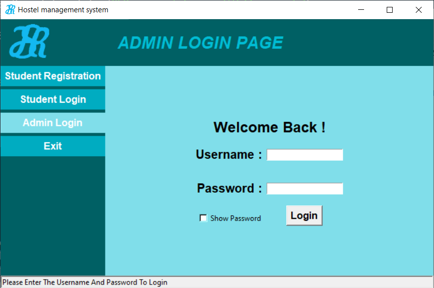

### Student Login

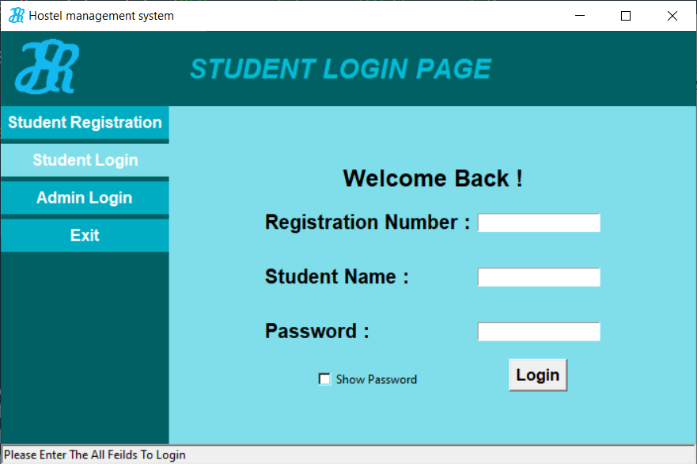

### Student Registration

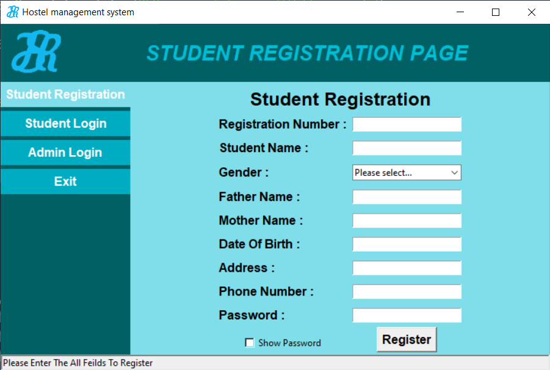

### Student Profile

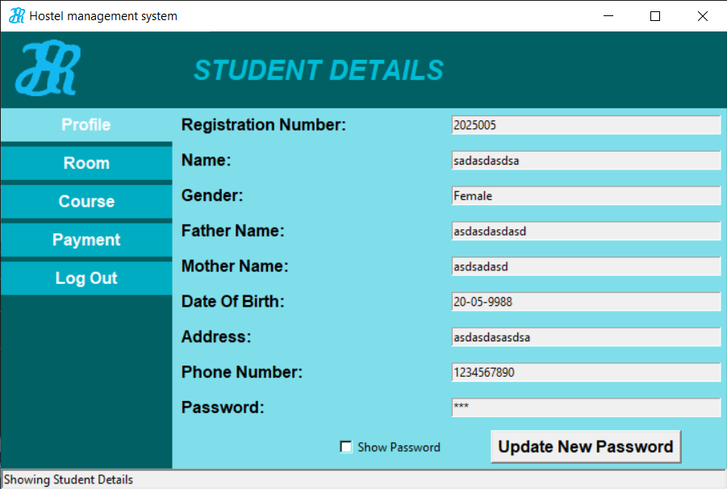

### Student Room

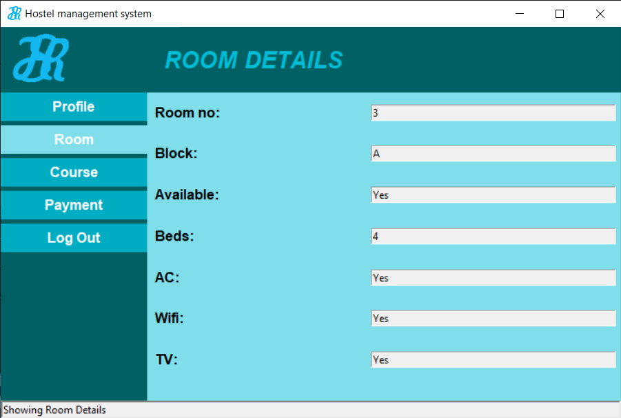

### Student Course

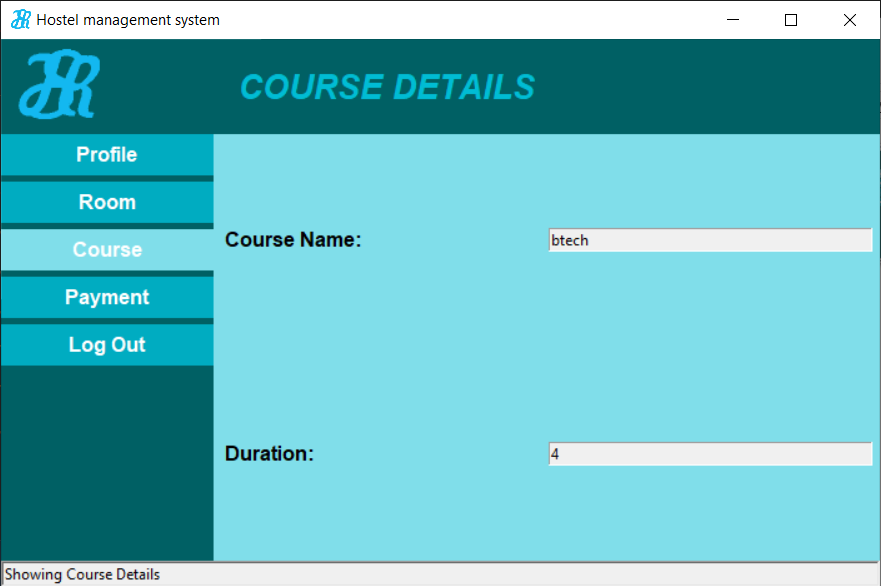

### Student Payment

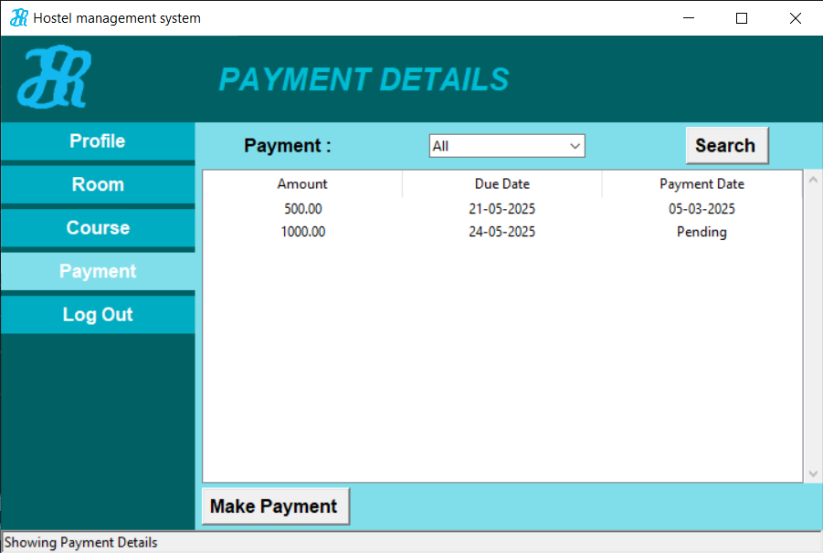

### Admin Dashboard

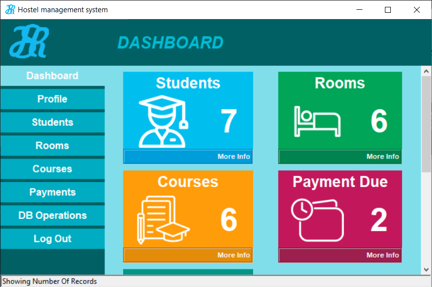

### Admin Profile

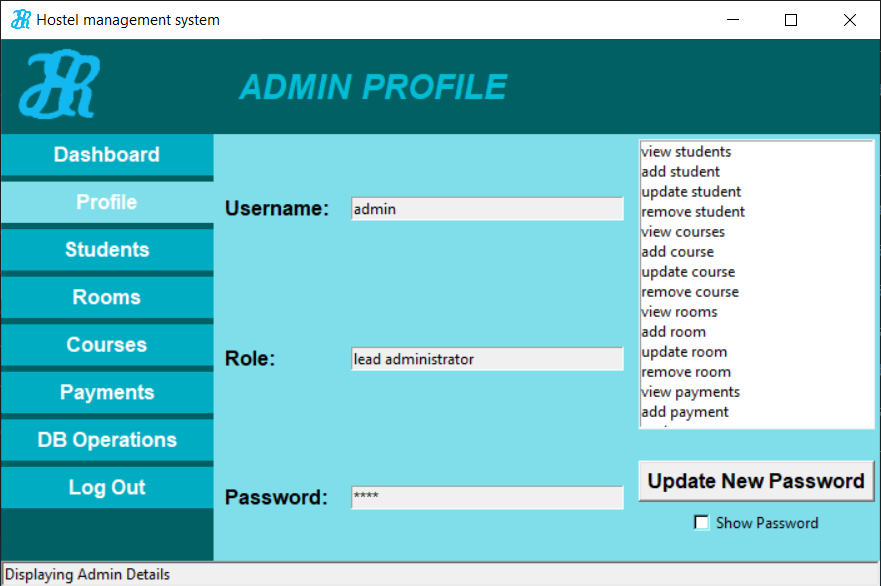

### Student Management


### Student Add / Modify

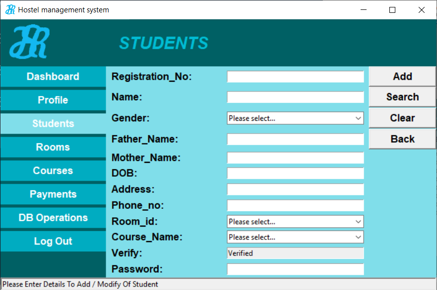

### Room Management

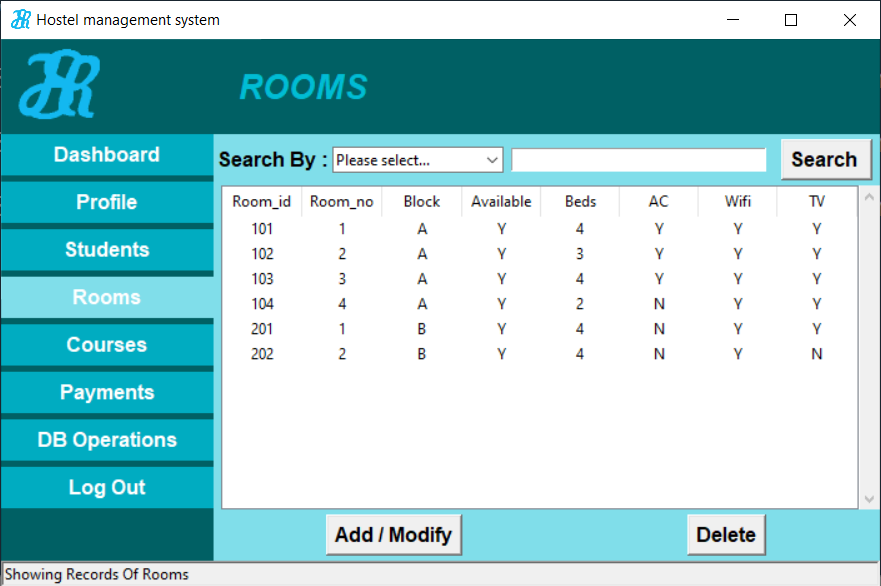

### Room Add / Modify

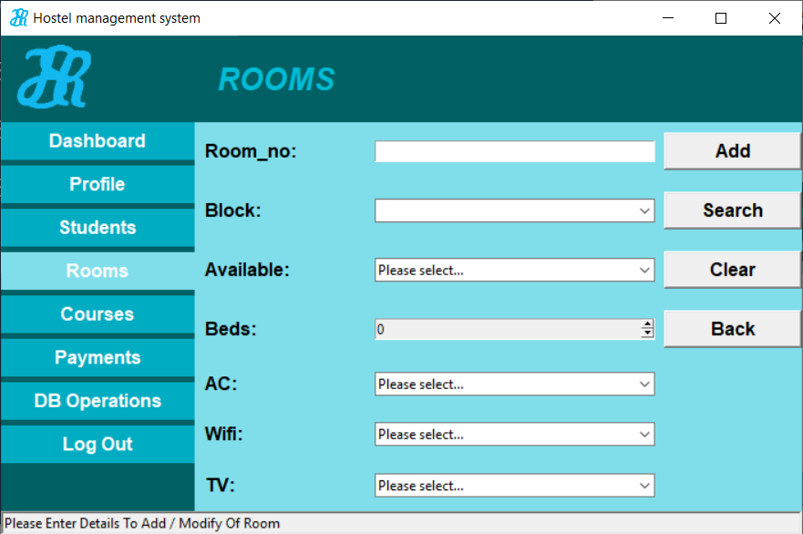

### Course Management

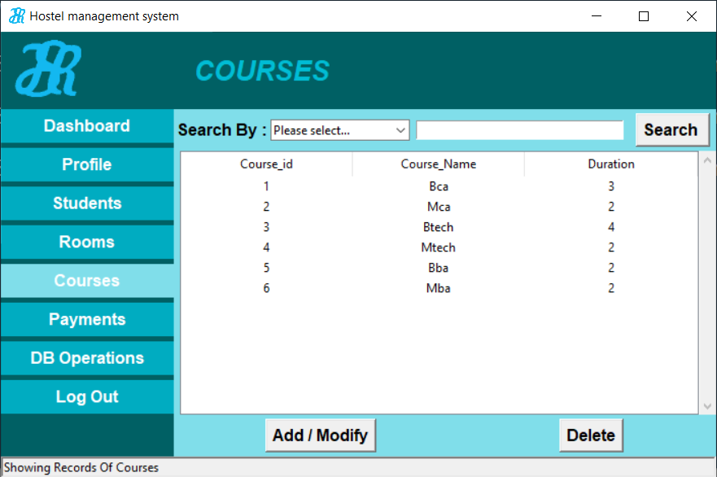

### Course Add / Modify

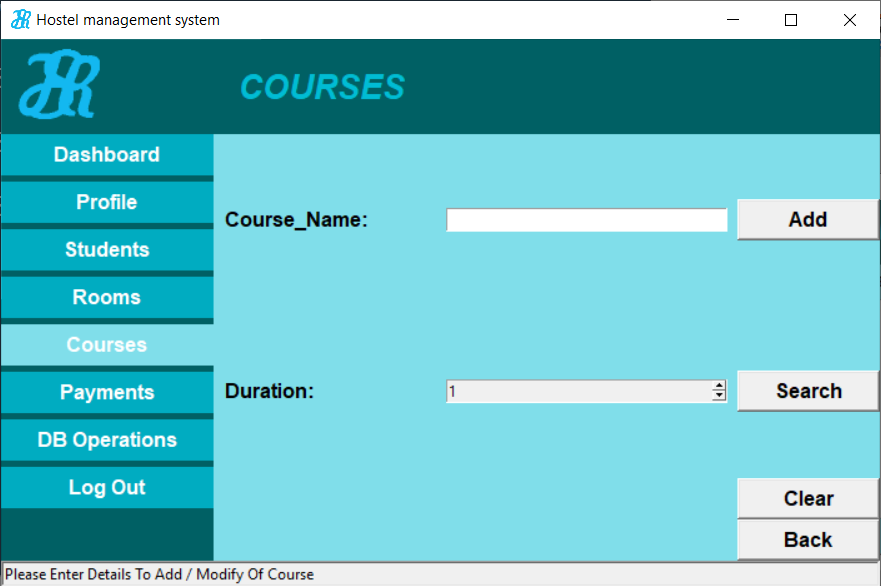

### Payment Management

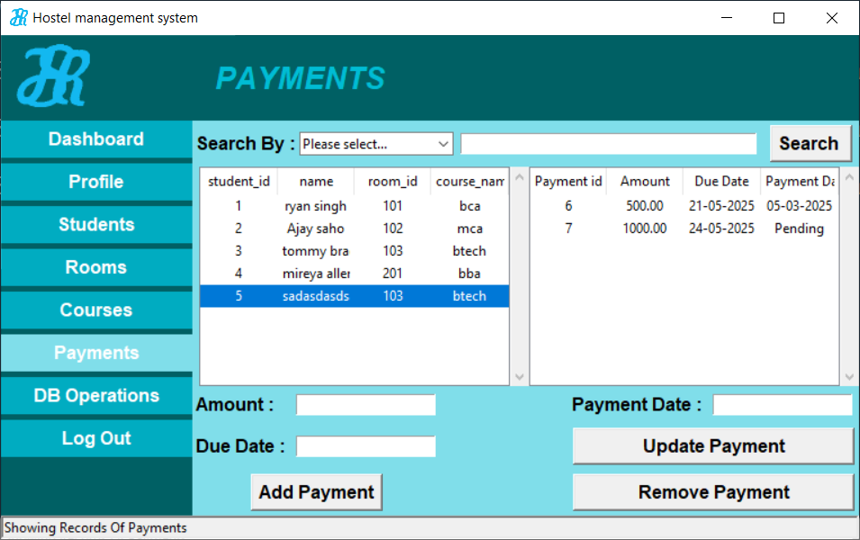

### Database Operations

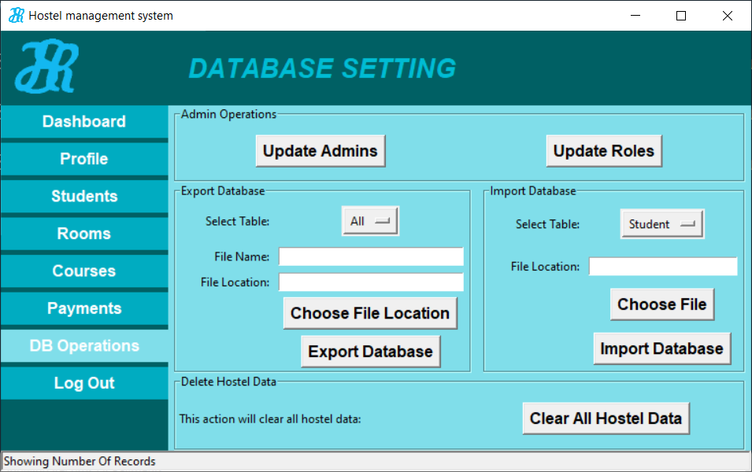

### Admin Management

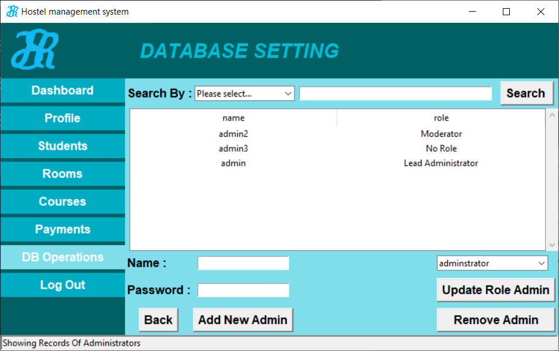

### Role & Permissions Management

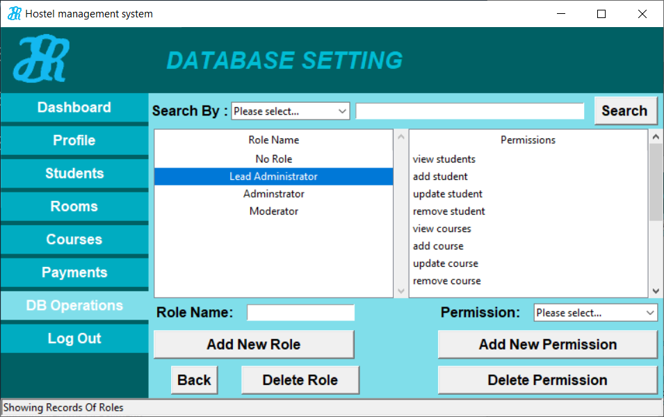

## Database

The project includes the MySQL database structure and required SQL data in:

`database/hosteldb.sql`

The SQL file can be used to create/import the database required by the application.

## Installation

### 1. Clone the Repository

```bash
git clone https://github.com/YOUR-USERNAME/hostel-management-system.git
```
### 2. Install Python

Make sure Python is installed on your system.

Check the installed version:

```bash
python --version
```

### 3. Install Required Python Packages

Install the required dependencies:

```bash
pip install -r requirements.txt
```

### 4. Configure MySQL

Make sure MySQL Server is installed and running.

Create/import the database using:

`database/hosteldb.sql`

Configure the database connection in the application according to your local MySQL configuration.

### 5. Run the Application

Run:

```bash
python hms.py
```

## Database Requirements

The application requires:

- MySQL Server
- MySQL database
- Python MySQL connector
- The database structure provided in `database/hosteldb.sql`

## Main Modules

### Student Management

Administrators can manage student records, including adding, modifying, searching, verifying, and deleting students.

### Room Management

Administrators can manage hostel rooms, including room information, availability, beds, and room facilities.

### Course Management

Administrators can manage available courses and their duration.

### Payment Management

Administrators can create, update, and remove student payment records.

Students can view their payment records and identify pending payments.

### Role Management

The Lead Admin can create and manage administrator roles and assign permissions to those roles.

### Permission Management

Permissions determine which operations an administrator is allowed to perform.

### Administrator Management

The Lead Admin can add administrators, remove administrators, and assign roles to administrators.

## Key Concepts Demonstrated

This project demonstrates practical implementation of:

- Desktop GUI development
- Python application development
- Tkinter GUI design
- MySQL database integration
- CRUD operations
- Authentication
- Student verification workflow
- Role-based access control
- Permission-based authorization
- Relational database operations
- Search and filtering
- Form handling
- Data validation
- Payment record management
- Database import/export operations
- Multi-level administrator management

## Project Purpose

This project was developed as a practical desktop application to demonstrate the design and implementation of a hostel management system using Python, Tkinter, and MySQL.

It focuses on managing students, rooms, courses, payments, administrators, roles, and permissions through a graphical user interface.

## License

This repository is intended primarily for portfolio and project demonstration purposes.

The source code is provided for viewing and evaluation purposes only. All rights are reserved by the author unless otherwise stated.

No permission is granted to copy, modify, distribute, reproduce, commercially use, or reuse the source code or project materials without prior written permission from the author.

For permission to use or reuse any part of this project, please contact the author.